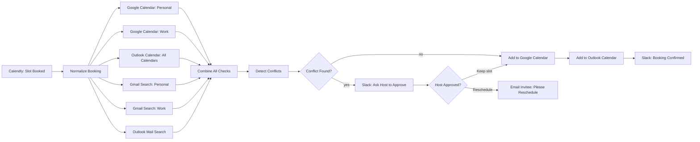

# Calendly Booking Conflict Check (n8n)

An n8n workflow that double-checks a Calendly booking against everything Calendly can't see: other calendars and email threads where someone has proposed a time. If the slot is clear it is confirmed and synced everywhere. If not, the host gets a Slack message with **Keep slot / Reschedule** buttons, and a "Reschedule" click emails the invitee asking them to pick a new time.

> Status: a design / demo workflow. It has not been run against live accounts.

## Flow

## What each stage does

1. **Trigger.** Calendly Trigger fires on `invitee.created`. A Set node extracts start/end time, event title, invitee name and email, and host email.
2. **Check everywhere (in parallel).**
   - Google Calendar events overlapping the slot, for the personal and work accounts.
   - Outlook events overlapping the slot, across all calendars.
   - Gmail (personal and work) and Outlook mail searched over the last 7 days for phrases that suggest a proposed time: "let's connect", "how about", "are you free", "works for me", "sometime", "this afternoon", "next week".
3. **Decide.** A Code node merges the results. Any overlapping calendar event or any matching email counts as a conflict, and it builds a short summary of what it found.
4. **No conflict:** create the event in Google Calendar and Outlook, then confirm in Slack.
5. **Conflict:** Slack DMs the host with the summary and two buttons. *Keep slot* continues to the sync step. *Reschedule* emails the invitee.

The six check nodes use "always output data" so the merge still fires when a source returns nothing; the Code node ignores the empty items.

## Setup

1. In n8n, **Import from file** and choose `workflow.json`.
2. Connect credentials: Calendly, Google Calendar (x2), Gmail (x2), Microsoft Outlook, Slack.
3. Fill the placeholders: the Slack username of the host (two Slack nodes) and the Outlook calendar to block in **Add to Outlook Calendar**.
4. Set the Google Calendar ID on the nodes if you don't use `primary`.

Notes:
- The Calendly webhook trigger needs Calendly's Standard plan or higher.
- Keyword matching on email is fuzzy. A match asks the host to decide rather than cancelling the booking automatically.
- Not included: a daily sweep to catch conflicts that appear after the booking, and tagging of interview emails by keyword.

## Files

- `workflow.json` - importable n8n workflow
- `README.md` - this file
